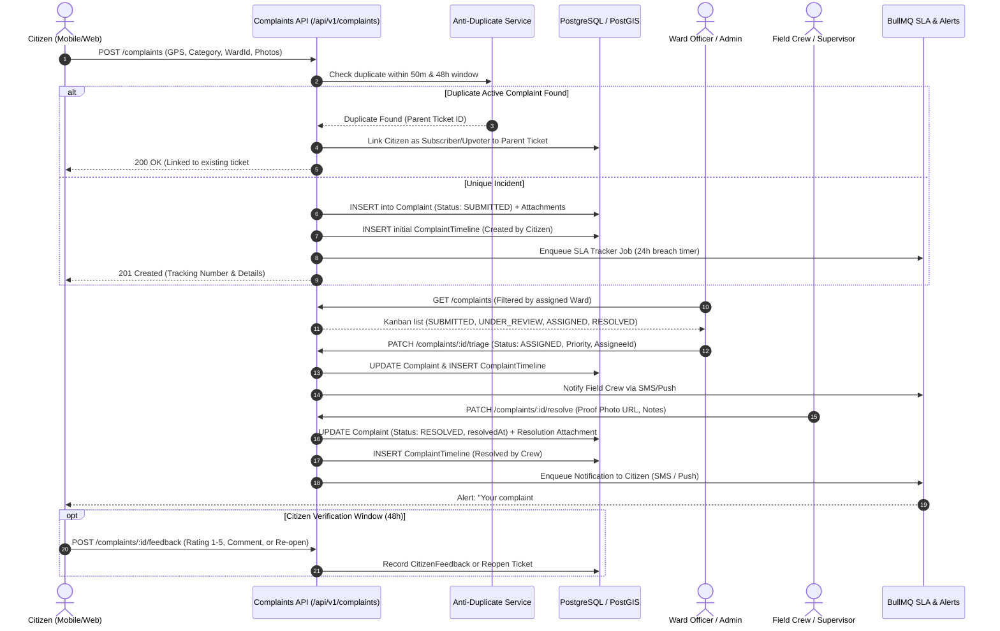
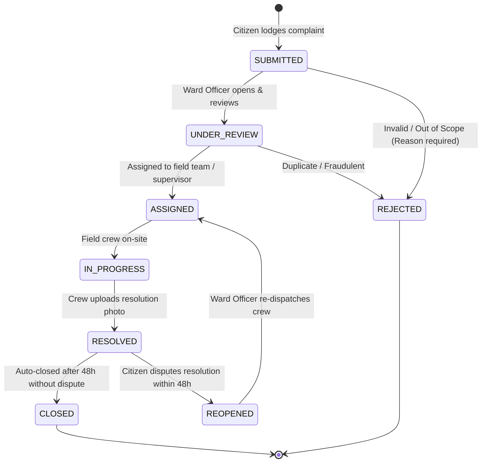
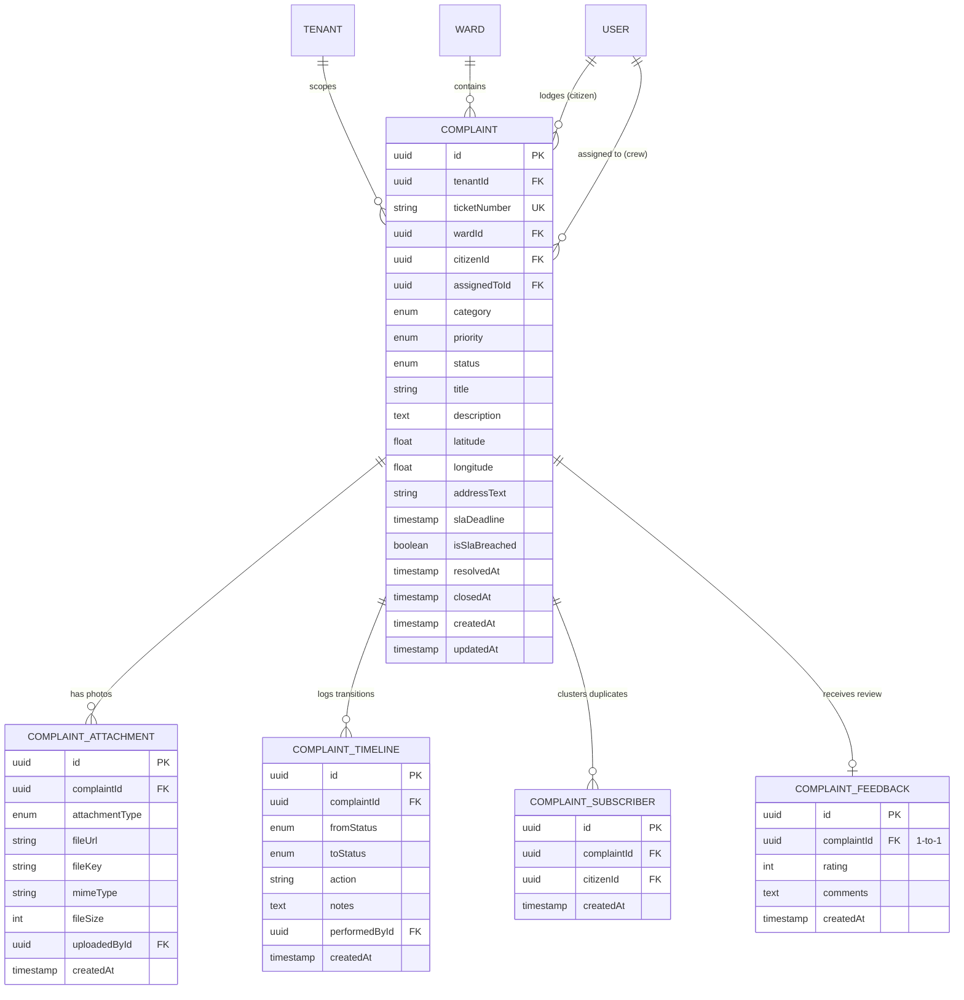

# WasteWise Phase 7: Citizen Grievances & Redressal Specification

> **Target Version**: Phase 7 Full-Stack Engineering Specification  
> **Scope**: Citizen Issue Reporting, Ward Officer Kanban Triage Board, Field Resolution Workflows, Automated SLA Escalations, and Anti-Duplicate Clustering  
> **Compliance**: Strict TypeScript (Zero `any`), Hard Multi-Tenant Isolation, Zero Data Duplication, DRY State Machine, Shadcn UI & React 19 Modern Paradigms

---

## 1. Architectural Overview & Workflow

Phase 7 provides citizens of Nepalese municipalities with an accessible, geo-tagged, and transparent grievance filing system while equipping Ward Officers and field crews with an actionable triage and resolution workflow.

```
┌────────────────────────────────────────────────────────────────────────────────────────┐
│                                   PHASE 7 SYSTEM WORKFLOW                              │
└────────────────────────────────────────────────────────────────────────────────────────┘

    CITIZEN (Mobile/Web)                           WARD OFFICER / ADMIN (Portal)
             │                                                  ▲
             │ 1. Lodge Complaint (Category,                    │
             │    GPS Pin, Photo, Description)                  │ 4. Triage & Assign
             ▼                                                  │    (To Supervisor / Crew)
    ┌─────────────────┐   Duplicate Check (50m, 48h)   ┌─────────────────┐
    │ Anti-Duplicate  ├───────────────────────────────►│  Ward Kanban    │
    │ Cluster Engine  │   [Clusters duplicate dumping] │  Triage Board   │
    └────────┬────────┘                                └────────┬────────┘
             │ Verified Unique                                  │
             ▼                                                  ▼ 5. In-Progress Dispatch
    ┌─────────────────┐   Breach (> 24h)               ┌─────────────────┐
    │ SLA Escalation  ├───────────────────────────────►│ Field Crew PWA  │
    │ BullMQ Worker   │   [Alerts Municipal Admin]     │ Resolution Run  │
    └─────────────────┘                                └────────┬────────┘
                                                                │
                                                                │ 6. Upload Proof Photo
                                                                │    & Mark Resolved
                                                                ▼
                                                       ┌─────────────────┐
                                                       │ Immutable Audit │
                                                       │ Timeline Record │
                                                       └────────┬────────┘
                                                                │
                                                                ▼ 7. Citizen Notified
                                                       [SMS / Push Alert]
```

### 1.1 End-to-End Sequence Diagram



---

## 2. State Machine & Transition Rules

To prevent illegal lifecycle bypasses (e.g. resolving a ticket without assignment, or reopening a closed ticket after the allowed grace period), status transitions are strictly enforced via a deterministic state transition matrix.



### Transition Enforcement Matrix

| Current Status | Permitted Next Status | Authorized Roles | Mandatory Payload / Condition |
| :--- | :--- | :--- | :--- |
| `SUBMITTED` | `UNDER_REVIEW`, `REJECTED` | `WARD_OFFICER`, `MUNICIPAL_ADMIN` | If `REJECTED`: `rejectionReason` (min 10 chars) |
| `UNDER_REVIEW` | `ASSIGNED`, `REJECTED` | `WARD_OFFICER`, `MUNICIPAL_ADMIN` | If `ASSIGNED`: valid `assignedToUserId` in tenant |
| `ASSIGNED` | `IN_PROGRESS`, `REJECTED` | `DRIVER`, `FIELD_WORKER`, `WARD_OFFICER` | Crew arrives at site |
| `IN_PROGRESS` | `RESOLVED` | `FIELD_WORKER`, `DRIVER`, `WARD_OFFICER` | `resolutionPhotoUrl` & `resolutionNotes` required |
| `RESOLVED` | `CLOSED`, `REOPENED` | System Cron (Auto-Close) / `CITIZEN` | If `REOPENED`: within 48h of `resolvedAt` |
| `REOPENED` | `ASSIGNED` | `WARD_OFFICER`, `MUNICIPAL_ADMIN` | Must reassign with priority escalation |

---

## 3. Database Schema & ER Diagram



### Prisma Schema Definitions (`backend/prisma/schema.prisma`)

```prisma
enum ComplaintCategory {
  MISSED_PICKUP
  ILLEGAL_DUMPING
  OVERFLOWING_BIN
  STAFF_MISCONDUCT
  DAMAGED_INFRASTRUCTURE
  OTHER
}

enum ComplaintPriority {
  LOW
  MEDIUM
  HIGH
  CRITICAL
}

enum ComplaintStatus {
  SUBMITTED
  UNDER_REVIEW
  ASSIGNED
  IN_PROGRESS
  RESOLVED
  REJECTED
  REOPENED
  CLOSED
}

enum ComplaintAttachmentType {
  REPORT_PHOTO
  RESOLUTION_PROOF
}

model Complaint {
  id              String            @id @default(uuid()) @db.Uuid
  tenantId        String            @map("tenant_id") @db.Uuid
  ticketNumber    String            @unique @map("ticket_number") @db.VarChar(32)
  wardId          String            @map("ward_id") @db.Uuid
  citizenId       String            @map("citizen_id") @db.Uuid
  assignedToId    String?           @map("assigned_to_id") @db.Uuid
  
  category        ComplaintCategory @default(MISSED_PICKUP)
  priority        ComplaintPriority @default(MEDIUM)
  status          ComplaintStatus   @default(SUBMITTED)
  
  title           String            @db.VarChar(160)
  description     String            @db.Text
  latitude        Float             @db.DoublePrecision
  longitude       Float             @db.DoublePrecision
  addressText     String?           @map("address_text") @db.VarChar(255)
  
  slaDeadline     DateTime          @map("sla_deadline")
  isSlaBreached   Boolean           @default(false) @map("is_sla_breached")
  rejectionReason String?           @map("rejection_reason") @db.Text
  
  resolvedAt      DateTime?         @map("resolved_at")
  closedAt        DateTime?         @map("closed_at")
  createdAt       DateTime          @default(now()) @map("created_at")
  updatedAt       DateTime          @updatedAt @map("updated_at")

  // Relationships
  tenant          Tenant            @relation(fields: [tenantId], references: [id], onDelete: Restrict)
  ward            Ward              @relation(fields: [wardId], references: [id], onDelete: Restrict)
  citizen         User              @relation("CitizenComplaints", fields: [citizenId], references: [id], onDelete: Restrict)
  assignedTo      User?             @relation("AssignedComplaints", fields: [assignedToId], references: [id], onDelete: SetNull)
  
  attachments     ComplaintAttachment[]
  timelines       ComplaintTimeline[]
  subscribers     ComplaintSubscriber[]
  feedback        ComplaintFeedback?

  @@index([tenantId, status])
  @@index([tenantId, wardId, status])
  @@index([tenantId, citizenId])
  @@index([tenantId, isSlaBreached, status])
  @@map("complaints")
}

model ComplaintAttachment {
  id              String                  @id @default(uuid()) @db.Uuid
  complaintId     String                  @map("complaint_id") @db.Uuid
  attachmentType  ComplaintAttachmentType @default(REPORT_PHOTO) @map("attachment_type")
  fileUrl         String                  @map("file_url") @db.Text
  fileKey         String                  @map("file_key") @db.VarChar(255)
  mimeType        String                  @map("mime_type") @db.VarChar(64)
  fileSize        Int                     @map("file_size")
  uploadedById    String                  @map("uploaded_by_id") @db.Uuid
  createdAt       DateTime                @default(now()) @map("created_at")

  complaint       Complaint               @relation(fields: [complaintId], references: [id], onDelete: Cascade)
  uploadedBy      User                    @relation(fields: [uploadedById], references: [id], onDelete: Restrict)

  @@index([complaintId])
  @@map("complaint_attachments")
}

model ComplaintTimeline {
  id              String           @id @default(uuid()) @db.Uuid
  complaintId     String           @map("complaint_id") @db.Uuid
  fromStatus      ComplaintStatus? @map("from_status")
  toStatus        ComplaintStatus  @map("to_status")
  action          String           @db.VarChar(64)
  notes           String?          @db.Text
  performedById   String           @map("performed_by_id") @db.Uuid
  createdAt       DateTime         @default(now()) @map("created_at")

  complaint       Complaint        @relation(fields: [complaintId], references: [id], onDelete: Cascade)
  performedBy     User             @relation(fields: [performedById], references: [id], onDelete: Restrict)

  @@index([complaintId, createdAt])
  @@map("complaint_timelines")
}

model ComplaintSubscriber {
  id          String    @id @default(uuid()) @db.Uuid
  complaintId String    @map("complaint_id") @db.Uuid
  citizenId   String    @map("citizen_id") @db.Uuid
  createdAt   DateTime  @default(now()) @map("created_at")

  complaint   Complaint @relation(fields: [complaintId], references: [id], onDelete: Cascade)
  citizen     User      @relation(fields: [citizenId], references: [id], onDelete: Cascade)

  @@unique([complaintId, citizenId])
  @@map("complaint_subscribers")
}

model ComplaintFeedback {
  id          String    @id @default(uuid()) @db.Uuid
  complaintId String    @unique @map("complaint_id") @db.Uuid
  rating      Int       @db.SmallInt // 1 to 5 stars
  comments    String?   @db.Text
  createdAt   DateTime  @default(now()) @map("created_at")

  complaint   Complaint @relation(fields: [complaintId], references: [id], onDelete: Cascade)

  @@map("complaint_feedbacks")
}
```

---

## 4. Zero Data Duplication & Anti-Duplicate Clustering

Illegal dumping and overflowing bin incidents are often reported by multiple neighbors simultaneously, which clutters the Ward Officer’s board with duplicate work orders.

### 4.1 Anti-Duplicate Deduplication Engine

```typescript
// Algorithm: Spatial & Temporal Proximity Match
const DUPLICATION_RADIUS_METERS = 50;
const DUPLICATION_WINDOW_HOURS = 48;

export async function findDuplicateComplaint(
  tenantId: string,
  wardId: string,
  category: ComplaintCategory,
  lat: number,
  lng: number
): Promise<Complaint | null> {
  // Only cluster communal incidents (Dumping, Overflowing Bin)
  if (category !== 'ILLEGAL_DUMPING' && category !== 'OVERFLOWING_BIN') {
    return null;
  }

  // Find active complaints in the same ward within the last 48 hours
  const activeCandidates = await prisma.complaint.findMany({
    where: {
      tenantId,
      wardId,
      category,
      status: { in: ['SUBMITTED', 'UNDER_REVIEW', 'ASSIGNED', 'IN_PROGRESS'] },
      createdAt: { gte: new Date(Date.now() - DUPLICATION_WINDOW_HOURS * 3600 * 1000) },
    },
    select: { id: true, ticketNumber: true, latitude: true, longitude: true },
  });

  for (const candidate of activeCandidates) {
    const distanceMeters = haversineDistanceMeters(lat, lng, candidate.latitude, candidate.longitude);
    if (distanceMeters <= DUPLICATION_RADIUS_METERS) {
      return candidate as unknown as Complaint;
    }
  }

  return null;
}
```

### 4.2 Behavior on Duplicate Detection:
1. Do **not** create a redundant `Complaint` record.
2. Insert a record into `ComplaintSubscriber` linking the reporting citizen.
3. Add a timeline note: `"Citizen [ID] added as subscriber (Reported duplicate incident at distance Xm)"`.
4. Return HTTP 200 with `{ isDuplicate: true, ticketNumber: existing.ticketNumber, message: "A complaint has already been logged for this location and is being handled." }`.
5. When the parent ticket is resolved, all subscribers receive resolution notification.

---

## 5. Security & Bug-Free Defensive Architecture

1. **Zero Client Trust on Tenant & Roles**:
   - `tenantId` is always injected from `req.tenant.id` (never from request body or URL param).
   - Citizen filing: `citizenId` is always locked to `req.user.id`.
   - Ward Officer actions: strictly validated against `req.user.wardId` (unless role is `MUNICIPAL_ADMIN` or `SUPER_ADMIN`).
2. **Safe Image Upload & File Integrity**:
   - File extensions validated against allowed MIME types (`image/jpeg`, `image/png`, `image/webp`).
   - Max file size: **5 MB** per attachment; max 3 photos per ticket.
   - S3/MinIO bucket keys format: `tenants/{tenantId}/complaints/{ticketNumber}/{uuid}.webp`.
   - Never serve raw unvalidated file names. Strip EXIF data server-side to protect citizen privacy.
3. **Anti-Spam Rate Limiting**:
   - Max **5 complaints per hour per citizen** enforced via Redis sliding window rate-limiter.
   - GPS coordinate boundary validation: Pin must fall within the assigned tenant municipality's bounding polygon.
4. **Idempotency & Race Condition Prevention**:
   - Ticket state transitions run inside `prisma.$transaction`.
   - Checking current status before updating prevents race conditions where two ward officers attempt simultaneous conflicting triage.

---

## 6. DRY Architecture & Module Structure

Following the repository's feature-based modular rules:

### Backend Structure (`backend/src/features/complaints/`)
```
backend/src/features/complaints/
├── complaints.controller.ts      # HTTP status codes & param parsing only (< 150 lines)
├── complaints.service.ts         # Business logic, state transitions, duplicate check (< 200 lines)
├── complaints.repository.ts      # Tenant-scoped Prisma queries & PostGIS spatial filters (< 200 lines)
├── complaints.routes.ts          # Express route bindings & RBAC guards
├── complaints.schema.ts          # Zod input schemas for lodge, triage, resolve, feedback
├── complaints.types.ts           # DTOs, interfaces, and state transition types
├── complaints.scheduler.ts       # Cron worker for SLA breach checks & 48h auto-closure
└── __tests__/
    ├── complaints.service.spec.ts
    ├── complaints.state-machine.spec.ts
    └── complaints.duplicate.spec.ts
```

### Frontend Structure (`frontend/src/features/complaints/`)
```
frontend/src/features/complaints/
├── api/
│   ├── useComplaints.ts          # TanStack Query hooks (fetch, lodge, triage, resolve)
│   └── complaints.actions.ts     # Next.js Server Actions / Action Handlers with React 19
├── components/
│   ├── CitizenComplaintForm.tsx  # Geo-pin selector, category picker, image preview
│   ├── ComplaintKanbanBoard.tsx  # Responsive triage board for Ward Officers
│   ├── ComplaintCard.tsx         # Reusable complaint ticket summary card
│   ├── ComplaintDetailSheet.tsx  # Slide-over drawer with timeline & resolution form
│   └── ComplaintFilterBar.tsx    # Ward selector, category & SLA filter
├── types/
│   └── complaints.types.ts       # Frontend TypeScript types mirrored from Zod schemas
└── utils/
    └── complaint-badge.util.ts   # Unified status to Shadcn Badge mapping
```

---

## 7. Frontend Guidelines: Shadcn UI & React 19 Paradigms

### 7.1 Strict Shadcn UI Component Reuse
Do **not** create custom CSS modals, raw `<button>`, or ad-hoc input fields. Use existing `@/shared/components/ui/` components:

| Feature Component | Existing Shadcn UI Component Used |
| :--- | :--- |
| Triage / Detail View | `Sheet`, `SheetContent`, `SheetHeader`, `SheetTitle` |
| Confirmation / Rejection Dialog | `AlertDialog`, `AlertDialogAction`, `AlertDialogCancel` |
| Filter & Category Select | `Select`, `SelectTrigger`, `SelectValue`, `SelectContent`, `SelectItem` |
| Status & Priority Badges | `Badge` (variant-coded: `emerald`, `amber`, `rose`, `slate`) |
| Citizen Feedback & Notes | `Textarea`, `Input`, `Label` |
| Complaint Cards | `Card`, `CardHeader`, `CardTitle`, `CardContent`, `CardFooter` |
| Tabs (All / Active / Breached) | `Tabs`, `TabsList`, `TabsTrigger`, `TabsContent` |
| Action Triggers | `Button` (`h-10` desktop, `h-12` mobile full-width) |
| Loading Skeletons | `Skeleton` |

### 7.2 React 19 Modern Hooks & Patterns

1. **`useActionState` for Citizen Grievance Filing**:
   - Replaces convoluted form state boilerplate.
   - Provides direct server action handling with pending state (`isPending`), optimistic input clearing, and schema validation error surfacing:
   ```tsx
   const [state, formAction, isPending] = useActionState(lodgeComplaintAction, initialFormState);
   ```

2. **`useOptimistic` for Instant Kanban Status Transitions**:
   - When a Ward Officer moves a card from `SUBMITTED` to `ASSIGNED`, the UI immediately reflects the new status without waiting for the network round-trip. If the request fails, it rolls back automatically with a Sonner toast notification.
   ```tsx
   const [optimisticComplaints, setOptimisticComplaintStatus] = useOptimistic(
     complaints,
     (state, { id, newStatus }: { id: string; newStatus: ComplaintStatus }) =>
       state.map((c) => (c.id === id ? { ...c, status: newStatus } : c))
   );
   ```

3. **`useTransition` for Non-Blocking Tab & Filter Switching**:
   - Switching between "My Wards", "High Priority", and "SLA Breaches" runs inside `startTransition` to prevent UI freezing during filter recalculations.

---

## 8. Verification & Quality Gates (Exit Criteria)

To consider Phase 7 complete:
1. **Automated Test Coverage**:
   - State machine transition unit tests (verify all invalid transitions throw `ValidationError`).
   - Anti-duplicate detection test: Verify that a complaint within 50m of an existing active ticket is clustered and does not duplicate work orders.
   - Hard multi-tenant isolation test: Confirm Ward Officer from Tenant A cannot view or triage complaints in Tenant B.
   - Role permission test: Citizens cannot change ticket status or assign tickets.
2. **Static Analysis & Build Verification**:
   - `backend`: `npx tsc --noEmit` with 0 errors.
   - `frontend`: `npm run build` succeeds with all pages static/SSR optimized.
   - Zero `any` in both frontend and backend.

