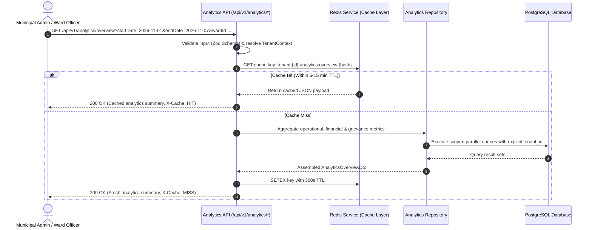
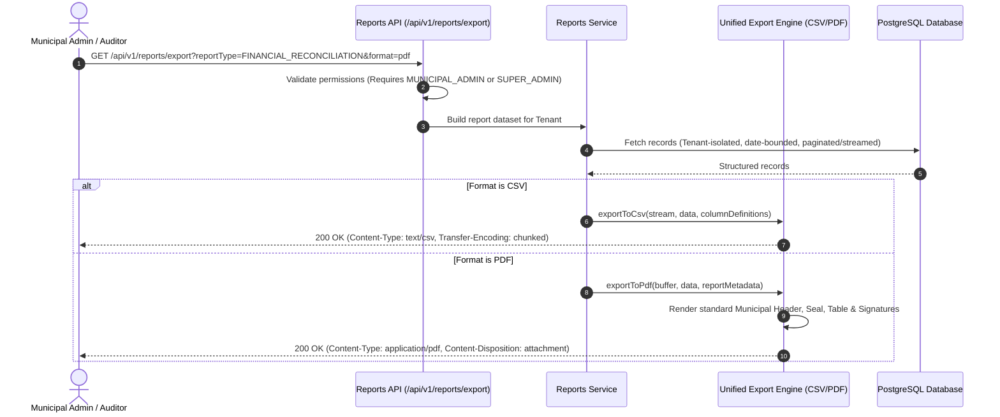
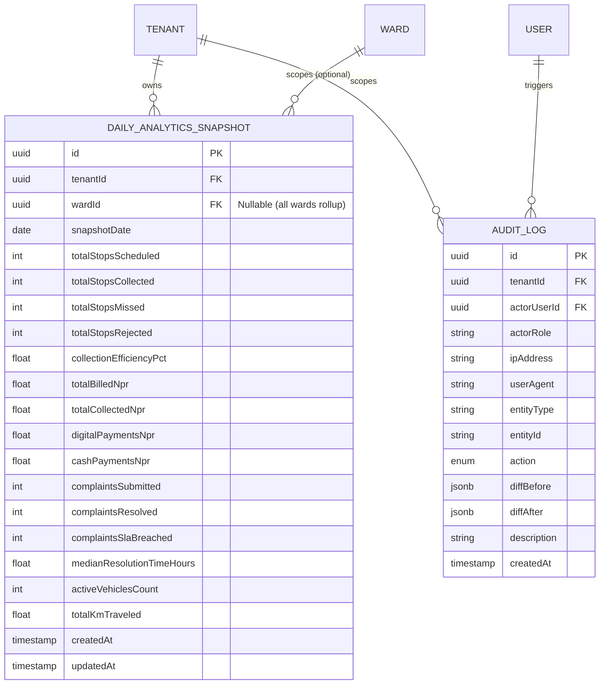

# WasteWise Phase 8: Municipal Analytics, Reporting, Audit Trail & System Readiness

> **Target Version**: Phase 8 Full-Stack Engineering Specification  
> **Scope**: Municipal Executive Analytics, Ward KPI Rollups, Unified Multi-Tenant Export Engine (CSV/PDF), Immutable Audit Trail, Deep Health & Readiness Probes, and End-to-End System Smoke Hardening  
> **Compliance**: Strict TypeScript (Zero `any`), Hard Multi-Tenant Isolation, Zero Duplication & Strict DRY Patterns, Centralized Error Handling, PostGIS Spatial Indexing, and Nepal Localization (`Asia/Kathmandu`, NPR `रू`)

---

## 1. Architectural Overview & Workflow

Phase 8 culminates the WasteWise SaaS platform by transforming operational transactions (Phases 1–7) into actionable executive intelligence, immutable governance audit logs, verifiable compliance reports, and resilient system health indicators.

```
┌────────────────────────────────────────────────────────────────────────────────────────┐
│                                   PHASE 8 SYSTEM ARCHITECTURE                          │
└────────────────────────────────────────────────────────────────────────────────────────┘

 [ MUNICIPAL EXECUTIVES & WARD OFFICERS ]       [ AUTOMATED EXTERNAL MONITORS / CRONS ]
                   │                                                │
                   │ HTTPS / JSON / Stream                          │ HTTP GET (/health/ready)
                   ▼                                                ▼
 ┌───────────────────────────────────────────────────────────────────────────────────────┐
 │                               EXPRESS 5 ROUTING GATEWAY                               │
 │   - TenantContextMiddleware (Tenant Isolation Injection)                             │
 │   - AuthGuard & RoleGuard (RBAC: MUNICIPAL_ADMIN, WARD_OFFICER, SUPER_ADMIN)          │
 │   - RateLimiterMiddleware (120 req/min for Analytics, 15 req/min for heavy Exports)   │
 └───────┬───────────────────────────────┬──────────────────────────────┬────────────────┘
         │                               │                              │
         ▼                               ▼                              ▼
 ┌──────────────────────┐    ┌──────────────────────┐    ┌───────────────────────────────┐
 │  ANALYTICS SERVICE   │    │    EXPORT SERVICE    │    │      AUDIT TRAIL SERVICE      │
 │  - Overview Metrics  │    │  (CSV & PDF Engine)  │    │  - Immutable Event Ingestion  │
 │  - Collection Rate   │    │  - Generic CSV Stream│    │  - Non-blocking Background Log│
 │  - Financial Rollup  │    │  - Modular PDF Render│    │  - Structured Actor Diff      │
 │  - SLA Turnaround    │    │  - DRY Header/Footer │    │  - Multi-Criteria Filtering   │
 └───────┬──────────────┘    └───────────┬──────────┘    └──────────────┬────────────────┘
         │                               │                              │
         ▼                               ▼                              ▼
 ┌──────────────────────┐    ┌──────────────────────┐    ┌───────────────────────────────┐
 │  REDIS CACHE LAYER   │    │   BULLMQ SCHEDULER   │    │      SYSTEM HEALTH PROBES     │
 │  - Key: t:{id}:stats │    │  - Nightly Rollup Job│    │  - Postgres Read/Write Latency│
 │  - TTL: 5–15 mins    │    │  - Heavy PDF Queue   │    │  - Redis Ping & Memory RSS    │
 └───────┬──────────────┘    └───────────┬──────────┘    └───────────────────────────────┘
         │                               │
         ▼                               ▼
 ┌───────────────────────────────────────────────────────────────────────────────────────┐
 │                         POSTGRESQL / POSTGIS DATA ENGINE                              │
 │   - DailyAnalyticsSnapshot (Pre-calculated daily aggregates per tenant/ward)          │
 │   - AuditLog (Immutable record of administrative, financial & route actions)          │
 │   - Existing Core Tables (Tenants, Routes, Stops, Invoices, Payments, Complaints)     │
 └───────────────────────────────────────────────────────────────────────────────────────┘
```

---

## 2. End-to-End Workflows & Sequence Diagrams

### 2.1 Executive Analytics Query Workflow (Cache-Aside Pattern)



### 2.2 Unified Report Export Workflow (Zero-Duplication Engine)



### 2.3 Non-Blocking Multi-Tenant Audit Logging Workflow

```mermaid
sequenceDiagram
    autonumber
    actor Actor as Authenticated User (Admin / Officer / Driver)
    participant Route as Express Protected Route
    participant Audit as Audit Logging Interceptor
    participant DB as PostgreSQL (audit_logs table)

    Actor->>Route: PATCH /api/v1/complaints/123/triage (Status -> ASSIGNED)
    Route->>Route: Process business logic & update database
    Route-->>Actor: 200 OK (Complaint updated successfully)
    
    par Asynchronous Audit Log Ingestion (Fire & Forget, Non-blocking)
        Route->>Audit: recordAudit({ tenantId, userId, action: 'UPDATE', entity: 'Complaint', diff })
        Audit->>DB: INSERT into audit_logs (tenant_id, user_id, action, entity_type, entity_id, diff, ip)
    end
```

---

## 3. Database Schema & ER Diagram

Phase 8 introduces two purpose-built tables that strictly adhere to **Hard Multi-Tenant Isolation** and prevent expensive real-time table scans on historical operational data.



### 3.1 Prisma Schema Additions (`backend/prisma/schema.prisma`)

```prisma
// ====================================================
// PHASE 8: MUNICIPAL ANALYTICS & AUDIT TRAIL ENGINE
// ====================================================

enum AuditAction {
  CREATE
  UPDATE
  DELETE
  STATUS_CHANGE
  PAYMENT_RECORDED
  ROUTE_DISPATCH
  EXPORT_GENERATED
  SECURITY_EVENT
}

model DailyAnalyticsSnapshot {
  id                      String   @id @default(uuid()) @db.Uuid
  tenantId                String   @map("tenant_id") @db.Uuid
  wardId                  String?  @map("ward_id") @db.Uuid
  snapshotDate            DateTime @map("snapshot_date") @db.Date

  // Operational Collection KPIs
  totalStopsScheduled     Int      @default(0) @map("total_stops_scheduled")
  totalStopsCollected     Int      @default(0) @map("total_stops_collected")
  totalStopsMissed        Int      @default(0) @map("total_stops_missed")
  totalStopsRejected      Int      @default(0) @map("total_stops_rejected")
  collectionEfficiencyPct Float    @default(0.0) @map("collection_efficiency_pct")

  // Financial & Revenue KPIs (NPR)
  totalBilledNpr          Decimal  @default(0.0) @map("total_billed_npr") @db.Decimal(12, 2)
  totalCollectedNpr       Decimal  @default(0.0) @map("total_collected_npr") @db.Decimal(12, 2)
  digitalPaymentsNpr      Decimal  @default(0.0) @map("digital_payments_npr") @db.Decimal(12, 2)
  cashPaymentsNpr         Decimal  @default(0.0) @map("cash_payments_npr") @db.Decimal(12, 2)

  // Grievance & SLA KPIs
  complaintsSubmitted     Int      @default(0) @map("complaints_submitted")
  complaintsResolved      Int      @default(0) @map("complaints_resolved")
  complaintsSlaBreached   Int      @default(0) @map("complaints_sla_breached")
  medianResolutionHours   Float    @default(0.0) @map("median_resolution_hours")

  // Fleet & Resource Utilization
  activeVehiclesCount     Int      @default(0) @map("active_vehicles_count")
  totalKmTraveled         Float    @default(0.0) @map("total_km_traveled")

  createdAt               DateTime @default(now()) @map("created_at")
  updatedAt               DateTime @updatedAt @map("updated_at")

  tenant                  Tenant   @relation(fields: [tenantId], references: [id], onDelete: Cascade)
  ward                    Ward?    @relation(fields: [wardId], references: [id], onDelete: SetNull)

  @@unique([tenantId, wardId, snapshotDate])
  @@index([tenantId, snapshotDate])
  @@index([tenantId, wardId, snapshotDate])
  @@map("daily_analytics_snapshots")
}

model AuditLog {
  id          String      @id @default(uuid()) @db.Uuid
  tenantId    String      @map("tenant_id") @db.Uuid
  actorUserId String?     @map("actor_user_id") @db.Uuid
  actorRole   Role?       @map("actor_role")
  ipAddress   String?     @map("ip_address") @db.VarChar(45)
  userAgent   String?     @map("user_agent") @db.VarChar(255)
  
  entityType  String      @map("entity_type") @db.VarChar(64)
  entityId    String      @map("entity_id") @db.VarChar(64)
  action      AuditAction @map("action")
  
  diffBefore  Json?       @map("diff_before")
  diffAfter   Json?       @map("diff_after")
  description String?     @db.VarChar(255)
  
  createdAt   DateTime    @default(now()) @map("created_at")

  tenant      Tenant      @relation(fields: [tenantId], references: [id], onDelete: Cascade)
  actorUser   User?       @relation(fields: [actorUserId], references: [id], onDelete: SetNull)

  @@index([tenantId, createdAt])
  @@index([tenantId, entityType, entityId])
  @@index([tenantId, actorUserId])
  @@index([tenantId, action])
  @@map("audit_logs")
}
```

---

## 4. Zero Duplication & Strict DRY Patterns

To ensure clean, maintainable, and unbloated code across the entire backend, Phase 8 mandates 4 foundational DRY patterns:

### 4.1 Generic Streaming CSV Exporter (`shared/utils/csv-exporter.ts`)
Instead of duplicating CSV formatting in every controller, implement one generic, type-safe streaming CSV utility:
```typescript
export interface CsvColumn<T> {
  header: string;
  accessor: (row: T) => string | number | boolean | null | undefined;
}

export const streamCsvResponse = <T>(
  res: Response,
  filename: string,
  columns: CsvColumn<T>[],
  dataStream: AsyncIterable<T[]> | T[]
): void => {
  res.setHeader('Content-Type', 'text/csv; charset=utf-8');
  res.setHeader('Content-Disposition', `attachment; filename="${filename}"`);
  
  const headerLine = columns.map((col) => `"${col.header.replace(/"/g, '""')}"`).join(',') + '\r\n';
  res.write(headerLine);

  for (const row of Array.isArray(dataStream) ? dataStream : []) {
    const rowLine = columns.map((col) => {
      const val = col.accessor(row);
      if (val === null || val === undefined) return '""';
      return `"${String(val).replace(/"/g, '""')}"`;
    }).join(',') + '\r\n';
    res.write(rowLine);
  }
  res.end();
};
```

### 4.2 Standardized Multi-Tenant PDF Document Builder
A reusable PDF template engine (`shared/utils/pdf-builder.ts` using `pdfkit`) that standardizes:
1. **Header**: Municipality Name, Province/District, Coat of Arms / Logo placeholder, Document Title.
2. **Metadata**: Generation timestamp in Nepal Time (`Asia/Kathmandu`), Generated By User & Role.
3. **Table & Styling**: Alternating shaded rows, auto-wrapping columns, currency right-alignment (`NPR रू`).
4. **Footer**: Confidentiality notice, system signature line, and page numbers `Page X of Y`.

### 4.3 Centralized Multi-Tenant Audit Logger Utility
A single non-blocking helper used across all feature controllers/services:
```typescript
export interface RecordAuditParams {
  tenantId: string;
  actorUserId?: string;
  actorRole?: Role;
  ipAddress?: string;
  userAgent?: string;
  entityType: string;
  entityId: string;
  action: AuditAction;
  diffBefore?: Record<string, unknown> | null;
  diffAfter?: Record<string, unknown> | null;
  description?: string;
}

export const logAuditEvent = (params: RecordAuditParams): void => {
  // Dispatched asynchronously without blocking the primary HTTP request
  setImmediate(async () => {
    try {
      await prisma.auditLog.create({ data: params });
    } catch (err) {
      console.error('[AuditLog] Failed to persist audit event:', err);
    }
  });
};
```

### 4.4 Unified Date Range & Nepal Timezone Helper
Consistent date range extraction for all analytics endpoints:
- Accepts ISO dates or relative presets (`today`, `yesterday`, `this_week`, `this_month`, `last_30_days`, `this_fiscal_year`).
- Anchors all date truncations to `Asia/Kathmandu` (`+05:45`).

---

## 5. API Endpoints Specification

### 5.1 Analytics Endpoints (`/api/v1/analytics`)

| Method | Endpoint | Authorized Roles | Description |
| :--- | :--- | :--- | :--- |
| `GET` | `/overview` | `MUNICIPAL_ADMIN`, `WARD_OFFICER`, `SUPER_ADMIN` | Executive KPI summary (collection rate, active fleet, revenue, open tickets) |
| `GET` | `/collections` | `MUNICIPAL_ADMIN`, `WARD_OFFICER`, `DISPATCHER` | Daily collection completion rate, missed pickup breakdown by ward & waste type |
| `GET` | `/financials` | `MUNICIPAL_ADMIN`, `SUPER_ADMIN` | Revenue rollups, digital (eSewa/Khalti) vs cash counters, outstanding dues |
| `GET` | `/complaints` | `MUNICIPAL_ADMIN`, `WARD_OFFICER` | Grievance resolution velocity, SLA breach rates, category distribution |
| `GET` | `/wards/:wardId` | `MUNICIPAL_ADMIN`, `WARD_OFFICER` | Detailed ward performance card with rank comparison against municipal average |

#### Sample Request & Response: `GET /api/v1/analytics/overview`
**Query Parameters**: `startDate=2026-11-01&endDate=2026-11-07&wardId=optional-uuid`
```json
{
  "success": true,
  "data": {
    "period": {
      "startDate": "2026-11-01T00:00:00.000Z",
      "endDate": "2026-11-07T23:59:59.999Z",
      "timezone": "Asia/Kathmandu"
    },
    "kpis": {
      "collectionEfficiency": {
        "scheduled": 1420,
        "collected": 1345,
        "missed": 45,
        "rejected": 30,
        "ratePct": 94.72
      },
      "finances": {
        "totalBilledNpr": "450000.00",
        "totalCollectedNpr": "385000.00",
        "collectionRatePct": 85.56,
        "digitalSharePct": 62.40,
        "cashSharePct": 37.60
      },
      "grievances": {
        "submitted": 28,
        "resolved": 25,
        "breached": 2,
        "resolutionRatePct": 89.29,
        "medianTurnaroundHours": 14.5
      },
      "fleet": {
        "totalVehicles": 12,
        "activeOnRoute": 9,
        "inMaintenance": 2,
        "available": 1
      }
    }
  },
  "meta": {
    "timestamp": "2026-11-07T14:55:00.000Z",
    "tenantId": "c88f17a9-d758-40b5-9008-8b9a7b975e5b"
  }
}
```

---

### 5.2 Reports & Export Endpoints (`/api/v1/reports`)

| Method | Endpoint | Query Params | Format | Description |
| :--- | :--- | :--- | :--- | :--- |
| `GET` | `/export/collections` | `startDate`, `endDate`, `wardId`, `format` (`csv`\|`pdf`) | CSV / PDF | Ward-by-ward collection logs & missed stop exceptions |
| `GET` | `/export/financial-reconciliation` | `startDate`, `endDate`, `gateway`, `format` | CSV / PDF | Audit-ready transaction ledger & digital gateway settlement |
| `GET` | `/export/complaints-sla` | `startDate`, `endDate`, `status`, `format` | CSV / PDF | Citizen grievance audit with SLA breach analysis |
| `GET` | `/export/ward-summary` | `wardId`, `month`, `year`, `format` | PDF | Comprehensive monthly municipal council review sheet |

---

### 5.3 Audit Trail Endpoints (`/api/v1/audit-logs`)

| Method | Endpoint | Authorized Roles | Description |
| :--- | :--- | :--- | :--- |
| `GET` | `/` | `MUNICIPAL_ADMIN`, `SUPER_ADMIN` | Paginated query of immutable audit events with actor, entity & date filters |
| `GET` | `/:id` | `MUNICIPAL_ADMIN`, `SUPER_ADMIN` | Detailed view of single audit record including full `diffBefore` and `diffAfter` |

---

### 5.4 System Health & Readiness Endpoints (`/health`)

| Method | Endpoint | Access | Purpose |
| :--- | :--- | :--- | :--- |
| `GET` | `/health` | Public | Lightweight liveness probe for load balancer (checks process alive) |
| `GET` | `/health/live` | Public | Kubernetes/ECS liveness probe |
| `GET` | `/health/ready` | Public / Admin | Deep readiness probe verifying Postgres read/write and Redis connectivity |

#### Sample Readiness Response: `GET /health/ready`
```json
{
  "status": "HEALTHY",
  "timestamp": "2026-11-07T14:55:00.000Z",
  "version": "1.0.0",
  "uptimeSeconds": 14238.45,
  "checks": {
    "database": {
      "status": "UP",
      "latencyMs": 4.2
    },
    "redis": {
      "status": "UP",
      "latencyMs": 1.1
    },
    "memory": {
      "status": "NORMAL",
      "heapUsedMb": 68.4,
      "heapTotalMb": 92.1,
      "rssMb": 114.8
    }
  }
}
```

---

## 6. Backend Feature Structure & Modularity

Following the **Feature-Based Architecture** and strict **150–200 lines per file** limit:

```
backend/src/features/
├── analytics/
│   ├── analytics.controller.ts        # Request handling, query parsing & response mapping
│   ├── analytics.service.ts           # Business calculations, metric formulas & Redis cache orchestration
│   ├── analytics.repository.ts        # Scoped Prisma queries & PostGIS aggregations
│   ├── analytics.routes.ts            # Route bindings, AuthGuard & RoleGuard
│   ├── analytics.schema.ts            # Zod validation for date filters and ward IDs
│   ├── analytics.types.ts             # Domain DTOs & response contracts
│   └── __tests__/
│       ├── analytics.service.spec.ts  # KPI calculation unit tests
│       └── analytics.routes.spec.ts   # Integration tests with tenant isolation
├── reports/
│   ├── reports.controller.ts          # Stream handler for CSV & PDF generation
│   ├── reports.service.ts             # Report dataset aggregation
│   ├── reports.routes.ts              # Route bindings
│   ├── reports.schema.ts              # Export parameter schemas
│   └── exporters/
│       ├── csv-report.exporter.ts     # DRY CSV streamer
│       └── pdf-report.exporter.ts     # DRY PDFKit template builder
├── audit/
│   ├── audit.controller.ts            # Audit query controller
│   ├── audit.service.ts               # Audit logging service & background queue
│   ├── audit.repository.ts            # Paginated tenant-scoped queries
│   ├── audit.routes.ts                # Route bindings
│   ├── audit.schema.ts                # Zod query filter schemas
│   └── audit.types.ts                 # Audit domain types
└── health/
    ├── health.controller.ts           # Liveness and deep readiness probes
    ├── health.service.ts              # Database and Redis ping utilities
    └── health.routes.ts               # Health route registration
```

---

## 7. End-to-End System Smoke Test Matrix (Phases 1–8)

Before Phase 8 can be certified as complete, an automated comprehensive lifecycle test (`backend/src/__tests__/e2e/complete-system-lifecycle.e2e.spec.ts`) verifies the unified flow across all modules:

```
[1. Create Tenant & Users] 
      │
      ▼
[2. Configure Ward & Service Zone]
      │
      ▼
[3. Register Property with GPS Coordinates]
      │
      ▼
[4. Create Service Plan & Subscribe Property]
      │
      ▼
[5. Generate Daily Route & Verify Dispatch]
      │
      ▼
[6. Simulate Ingestion of Throttled GPS Breadcrumbs]
      │
      ▼
[7. Complete Route Stops (COLLECTED / MISSED)]
      │
      ▼
[8. Generate Monthly Invoice & Process Mock eSewa Payment]
      │
      ▼
[9. Lodge Grievance for Missed Stop, Triage & Mark Resolved]
      │
      ▼
[10. Query Analytics Dashboard & Verify Data Matches Invoices, Pickups & Tickets]
      │
      ▼
[11. Export Financial & Collection CSV/PDF Reports and Validate Header/Data Integrity]
      │
      ▼
[12. Inspect Audit Log to Confirm All 11 Preceding Actions Were Immutably Recorded]
```

---

## 8. Frontend Integration Roadmap (Preview)

While backend development is executed first, Phase 8 frontend components will map 1-to-1 to these backend features using the design system defined in `GEMINI.md`:
1. **Executive Dashboard (`app/(dashboard)/analytics/page.tsx`)**:
   - Recharts / Chart.js KPI cards with Segoe UI typography and emerald/slate color tokens.
   - Interactive date range picker and Ward multi-select filter.
2. **Reports Center (`app/(dashboard)/reports/page.tsx`)**:
   - Instant download buttons for PDF and CSV with loading transitions (`useTransition`).
3. **Audit Trail Inspector (`app/(dashboard)/audit/page.tsx`)**:
   - Filterable data table with expandable before/after JSON diff drawers.
4. **System Health Status (`app/(dashboard)/settings/system/page.tsx`)**:
   - Real-time indicator of API, Database, and Redis health.

---

## 9. Verification & Exit Criteria

1. **Strict TypeScript & Schema Compilation**: Zero `any`, clean `tsc --noEmit` and clean Prisma migration generation.
2. **Tenant Scoping Guarantee**: Automated test verifies that Municipal Admin from Tenant A querying `/analytics/overview` or `/audit-logs` receives strictly 0 records belonging to Tenant B.
3. **P95 Latency Compliance**: Analytics overview API response time under 300ms using Redis caching.
4. **Stream Resilience**: CSV and PDF export endpoints handle 1,000+ records without memory leaks or request timeouts.
5. **E2E Smoke Suite Pass**: 100% passing tests for the full multi-phase lifecycle test suite.

